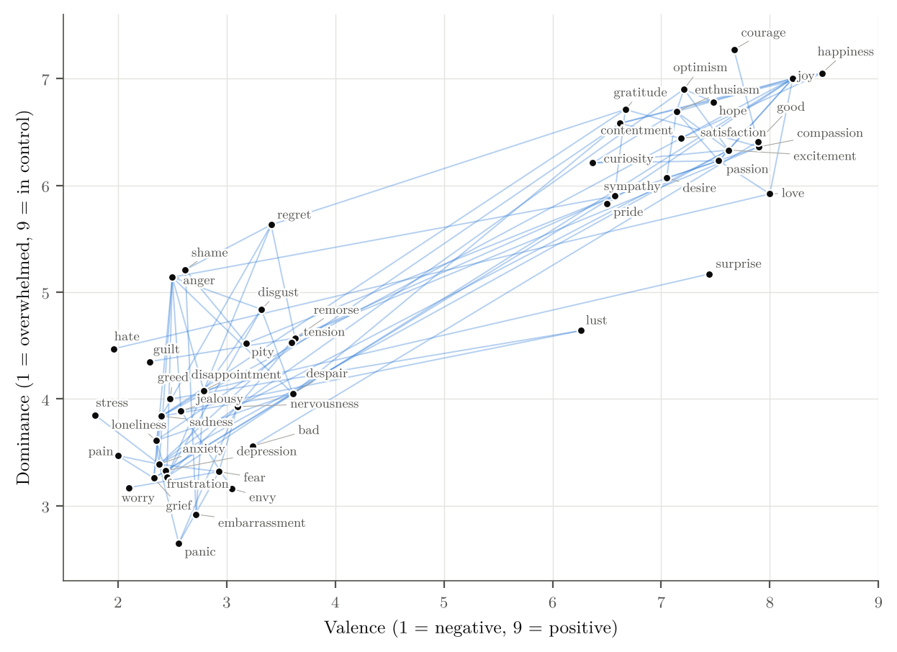

# How Does Language Organize Emotions?

**Distributional semantics meets valence, arousal and dominance norms**

Nathan Tessot · CPES Data Science & Cultural Sciences, Université PSL · May 2026

📄 **[Read the report (PDF)](report/How_Does_Language_Organize_Emotions_Tessot.pdf)** · 📓 [Notebook](Emotions_Language_Nathan_TESSOT.ipynb)

---

## Question

Do emotion words that are used in similar linguistic contexts also share similar
psychological properties? This project compares two independent representations
of 53 English emotion words:

- **How they are used**: Word2Vec embeddings trained on Google News
  (Mikolov et al., 2013). Two emotions are *semantically linked* when the cosine
  similarity of their vectors is at least 0.50.
- **How they are experienced**: valence, arousal and dominance (VAD) ratings
  from Warriner et al. (2013), each on a 1–9 scale.

## Key results



- **Linked emotions are psychologically closer.** The mean Euclidean distance in
  VAD space is 2.26 for linked pairs and 3.63 for the other pairs
  (Welch's t = −7.58, p < 10⁻¹¹). A permutation test that keeps the network fixed
  and shuffles VAD profiles across words confirms it (p < 10⁻⁴).
- **Valence and dominance matter, arousal does not.** In a logistic regression on
  the per-axis differences, valence (p = 0.016) and dominance (p = 0.021) both
  predict semantic proximity, with almost identical standardized effects
  (−0.46 and −0.45 log-odds per standard deviation). Arousal has no detectable
  effect (p = 0.72).
- **Interpretation.** Emotional vocabulary is organized not only by how pleasant an
  emotion is, but also by how much control it conveys. The initial hypothesis that
  valence alone drives the structure is only partly supported.

## Repository structure

```
├── Emotions_Language_Nathan_TESSOT.ipynb   Full analysis, step by step
├── Ratings_Warriner_et_al.csv              VAD norms (Warriner et al., 2013)
├── requirements.txt
└── report/
    ├── How_Does_Language_Organize_Emotions_Tessot.pdf   5-page report
    ├── main.tex                                         LaTeX source
    ├── figures/                                         Figures used in the report
    └── scripts/
        ├── make_figures.py                              Regenerates figures and statistics
        ├── data.json                                    VAD coordinates and Word2Vec links
        └── emotions_vad.csv                             VAD ratings of the 53 words
```

## How to run

```bash
pip install -r requirements.txt
jupyter notebook Emotions_Language_Nathan_TESSOT.ipynb
```

The first run downloads the pre-trained Word2Vec model (about 1.7 GB); it is then
cached locally.

To rebuild the report figures without downloading the model:

```bash
cd report/scripts
python make_figures.py
```

The report compiles with `pdflatex main.tex` from the `report/` folder (or by
importing that folder into Overleaf).

## Limitations

English only, a single mainly American rating sample, a hand-picked list of words,
a single similarity threshold, and static embeddings that place antonyms close
together. See section 4 of the report for details.

## References

- Warriner, A. B., Kuperman, V., & Brysbaert, M. (2013). Norms of valence, arousal,
  and dominance for 13,915 English lemmas. *Behavior Research Methods*, 45(4),
  1191–1207. https://doi.org/10.3758/s13428-012-0314-x
- Mikolov, T., Chen, K., Corrado, G., & Dean, J. (2013). Efficient estimation of word
  representations in vector space. arXiv:1301.3781. https://arxiv.org/abs/1301.3781
- Krackhardt, D. (1988). Predicting with networks: Nonparametric multiple regression
  analysis of dyadic data. *Social Networks*, 10(4), 359–381.
